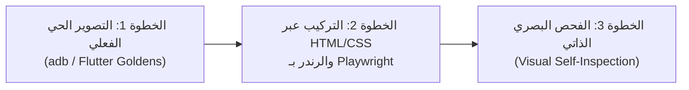

# 🎨 الوحدة 5: المصنع الآلي للافتة ولقطات الشاشة (M05_STORE_VISUAL_PIPELINE)
## The Automated Real-Capture & HTML/CSS Playwright Visual Rendering Engine

---

## 1. العلة الجذرية التي يحسمها هذا البروتوكول
* **مشكلة النماذج السابقة**: محاولة الوكيل الذكي رسم الصور والأيقونات من الصفر برمجياً عبر سكربتات Python PIL بدائية ومسطحة، مما يؤدي إلى إنتاج لافتات فارغة تفتقر للهوية البصرية وغياب لقطات الشاشة الحقيقية للتطبيق.
* **الحل الهندسي الإلزامي**: اعتماد خط إنتاج مؤتمت من 3 خطوات يعتمد على **التصوير الحي الحقيقي** ثم **التركيب البصري عبر محرك HTML/CSS فائق الجودة والتقاطه بـ Playwright**.

---

## 2. الخطوات الإلزامية الثلاث لخط الإنتاج البصري:

### الخطوة 1: التصوير الحي الفعلي للشاشات (Real App Capture First)
* يتم تشغيل التطبيق فعلياً (في محاكي أندرويد أو عبر تشغيل اختبارات التكامل/Golden Tests).
* التقاط 5 شاشات على الأقل في الوضع العربي (RTL) و 5 شاشات في الوضع الإنجليزي (LTR) وحفظها في:
  `/store_assets/raw_captures/ar/` و `/store_assets/raw_captures/en/`:
  - `01_dashboard.png` (الشاشة الرئيسية والمؤشرات)
  - `02_catalog.png` (سجلات وقوائم البيانات)
  - `03_details.png` (شاشة تفاصيل العنصر/العمليات)
  - `04_analytics.png` (الرسوم البيانية والتقارير)
  - `05_settings.png` (الإعدادات وتبديل اللغة والأمان)
* **بوابة توقف إلزامية (Stop Gate)**: يُحظر تماماً الانتقال للخطوة 2 إذا كانت الصور الملتقطة سوداء، فارغة، أو غير مكتملة.

---

### الخطوة 2: البناء البصري عبر محرك HTML/CSS والالتقاط بـ Playwright
* يقوم الوكيل بتوليد قوالب HTML/CSS نظيفة ومجهزة بأحدث معايير التصميم:
  - دعم خطوط الويب الحديثة (Cairo / Tajawal / IBM Plex Sans Arabic).
  - استخدام خامات الزجاج الحقيقية (Glassmorphism، `backdrop-filter: blur()`).
  - تطبيق التدرجات اللونية العميقة والإضاءات المحيطية (Ambient Lighting Glow).
  - وضع إطار الهاتف الذكي ثلاثي الأبعاد المائل بظلال واقعية متعددة الطبقات.
  - إدراج صورة الشاشة الملتقطة فعلياً داخل شاشة مجسم الهاتف.
* التقاط المخرجات بدقة متناهية عبر أداة المتصفح المدمجة (`playwright-cli` أو سكربت Node.js):
  - **اللافتة الترويجية**: التقاط بدقة `1024x500 px` وحفظها في `store_assets/feature_graphic_1024x500.png`.
  - **لقطات الشاشة الترويجية**: التقاط بدقة `1080x2400 px` (5 صور عربية في `store_assets/screenshots/ar/` و 5 صور إنجليزية في `store_assets/screenshots/en/`).

---

### الخطوة 3: الفحص البصري الذاتي الإلزامي (Visual Self-Inspection)
* يُلزم الوكيل بفتح وفحص الصور الناتجة برمجياً والتأكد من:
  1. سلامة محاذاة الخطوط العربية وعدم تقطع الحروف أو ظهورها كرموز مشوهة.
  2. امتلاء شاشة الهاتف باللقطة الحقيقية دون أي فراغات بيضاء أو سوداء.
  3. تناسق التباين اللوني والظلال الواقعية.
* إرفاق أحجام الصور ومساراتها في تقرير الإنجاز النهائي.
