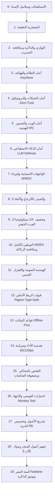

# 🛡️ البروتوكول الهندسي العالمي الموحد والتحصين الشامل للمشاريع والتطبيقات v10.0
## (The Supreme Universal Engineering, Security, Localization & Store Architecture Protocol)
### 🏛️ المعتمد لجميع مشاريع وتطبيقات: د. حسين الجابري (Dr. Hussein Al-Jaberi)
**المرجع الهندسي والتنفيذي الدائم الموحد - دمج الترسانة الكاملة لـ (2,465+ مهارة ذكية، أمن Cloudflare، تصميم Apple الانسيابي، متطلبات المتجر الكاملة، وقواعد التوطين الثنائي)**

---

## 🛑 القواعد النظامية الإلزامية غير القابلة للتفاوض (Non-Negotiable Core Rules)

### 1. القانون الحديدي للتنقيح المنهجي والتحقق الصارم (`systematic-debugging` & `verification-before-completion`)
* يُمنع منعاً باتاً التخمين، أو المجاملات، أو تقديم حلول ترقيعية أو افتراضية؛ يجب تتبع تدفق البيانات للخلف إلى مصدره الجذري الأول (Root Cause Analysis).
* يُمنع إعلان اكتمال أي مرحلة إلا بعد تشغيل الاختبارات الفعلية وإثبات عمل الميزة بنجاح تام رقمياً (`Exit Code 0`).

### 2. قاعدة التوطين الإلزامي الثنائي ومتعدد اللغات (Mandatory Bilingual AR/EN Standard)
* **دعم العربية والإنجليزية إلزامي 100%**: كل تطبيق يجب أن يعمل باللغتين العربية والإنجليزية بشكل أصيل وأساسي.
* **إلزامية التعريب والإنجليزي**: إذا وُجد التطبيق باللغة العربية فقط، يُلزم البروتوكول بتوليد وتفعيل النسخة الإنجليزية فوراً (`values/strings.xml` و `values-ar/strings.xml` أو ملفات `.arb` / `.json`). وإذا كان التطبيق يدعم لغات إضافية فهذا ميزة إضافية مرحب بها.
* **التبديل الذكي للغة**:
  - التكيف التلقائي مع لغة هاتف المستخدم عند التشغيل الأول.
  - توفير زر تبديل يدوي فوري بين (العربية / English) داخل شاشة الإعدادات يستجيب خلال 0ms دون الحاجة لإعادة تشغيل التطبيق.
* **هندسة الاتجاه (RTL & LTR)**:
  - ضبط كامل لاتجاه الواجهات من اليمين لليسار (RTL) للعربية، ومن اليسار لليمين (LTR) للإنجليزية.
  - قلب الأيقونات الاتجاهية (الأسهم، مسارات التقدم، الرجوع) تلقائياً، مع الحفاظ على اتجاه الأيقونات الثابتة (الكاميرا، الساعة، الإعدادات).

### 3. قواعد علي الجابري الإلزامية لتسمية وبناء تطبيقات الأندرويد (APK / AAB Naming & Output Rule)
* **حظر الأسماء الافتراضية العامة**: يُمنع منعاً باتاً إنتاج أو ترك أي ملف بالاسم الافتراضي العام للنظام مثل `app-debug.apk` أو `app-release.aab`.
* **التسمية الثلاثية القياسية بالإنجليزية الصريحة**: يتم ضبط وتعديل ملفات البناء (`build.gradle` / `.kts`) لتنتج تلقائياً في مجلد المخرجات والمجلد الرئيسي للمشروع ثلاث نسخ مسمية بوضوح:
  1. حزمة التثبيت المباشر: `[AppName_En]_v[VersionName]_[buildType].apk`
  2. حزمة المتجر الرسمية: `[AppName_En]_v[VersionName]_[buildType].aab`
  3. ملف فك التشفير والتعتيم: `[AppName_En]_v[VersionName]_mapping.txt`
* **النسخ الفوري لجذر المشروع**: يتم نسخ الملفات الثلاثة مباشرة إلى المجلد الرئيسي للمشروع بعد كل بناء ناجح لتكون جاهزة للنقل والتثبيت فوراً.
* **اسم التطبيق النقي على شاشة الهاتف (Launcher Name)**: يجب أن يظهر باسم التطبيق النقي فقط **بدون أي رقم إصدار نهائياً**، ويتكيف مع لغة جهاز المستخدم تلقائياً:
  - يظهر بالعربية الصريحة للأجهزة العربية (`values-ar/strings.xml` مثل `فقاستي` أو `التقويم المحمدي`).
  - يظهر بالإنجليزية للأجهزة غير العربية (`values/strings.xml` مثل `Faqasati` أو `AlMohammadi`).

### 4. عزل وتأمين البيانات وسلاسل الإمداد (`SUPPLY-CHAIN-AND-RELEASE`)
* حجب ملفات التوقيع `*.jks`, `*.keystore`, و `key.properties`, و `.env` داخل `.gitignore` فوراً.
* منع وجود أي مفاتيح API أو أسرار مشفرة ثابتاً في الكود (No Hardcoded Secrets).
* حظر تضمين ملفات الـ APK أو الحزم السابقة داخل مجلد الأصول (`ignoreAssetsPattern '!*.bin:!*.apk'`).

---

# 📦 حزمة متجر التطبيقات الشاملة (Google Play & App Store Complete Assets Kit)
تُولد هذه الحزمة تلقائياً لكل تطبيق لضمان القبول الفوري في المتاجر دون أي تأخير أو رفض:

### 1. الأصول البصرية الإلزامية للمتجر (Visual Store Assets):
* **أيقونة التطبيق عالية الدقة (App Icon)**:
  - الأبعاد: `512x512 px` بصيغة `PNG 32-bit`.
  - المتطلبات: زوايا قائمة (المتجر يطبق التقويس تلقائياً)، خلفية معتمة غير شفافة، بدون ظلال متساقطة خارجية، حجم الملف `<= 1024 KB`.
* **اللافتة الترويجية الرسمية (Feature Graphic)**:
  - الأبعاد: `1024x500 px` بصيغة `PNG` أو `JPEG`.
  - المتطلبات: بدون إطارات خارجية، تعبر عن الهوية البصرية، نسبة النص لا تتجاوز 20% في المنتصف، حجم الملف `<= 15 MB`.
* **لقطات الشاشة الترويجية للهواتف (Phone Screenshots)**:
  - الأبعاد: `1080x1920 px` (نسبة 9:16) أو `1080x2400 px`.
  - العدد: بين 4 إلى 8 لقطات عالية الدقة لكل لغة (عربي وإنجليزي).
  - التصميم: وضع الشاشات داخل إطارات هواتف ثلاثية الأبعاد (3D Device Mockup) مع شريط علوي يحمل عنواناً وظيفياً واضحاً يبرز ميزة الشاشة.
* **لقطات الشاشة للأجهزة اللوحية (7-inch & 10-inch Tablets)**:
  - الأبعاد: `1200x1920 px` أو `2048x1536 px` بحد أدنى 4 لقطات لضمان شارة التوافق مع الأجهزة اللوحية.

### 2. مصفوفة البيانات الوصفية والـ ASO (Store Metadata Pack):
* **اسم التطبيق (App Title)**:
  - العربية: `<= 30 حرفاً` (مثل: `فقاستي: إدارة وتتبع التفقيس الذكي`).
  - الإنجليزية: `<= 30 حرفاً` (مثل: `Faqasati: Smart Egg Incubator`).
* **الوصف القصير (Short Description)**:
  - العربية: `<= 80 حرفاً` يوضح القيمة الفورية للمستخدم.
  - الإنجليزية: `<= 80 حرفاً` مركز ومباشر يخلو من الكلمات الترويجية الرنانة.
* **الوصف الكامل (Full Description)**:
  - الطول: `<= 4000 حرف` باللغتين العربية والإنجليزية.
  - الهيكل:
    1. فقرة تعريفية ملهمة (Value Proposition).
    2. قائمة الميزات الرئيسية (Core Features) بنقاط واضحة.
    3. آلية العمل دون إنترنت (Offline-First Capability).
    4. الأمان وحماية الخصوصية.
    5. الكلمات المفتاحية الاستراتيجية غير المحشوة (Organic ASO Keywords).
* **معلومات الدعم والسياسات**:
  - رابط سياسة الخصوصية الصريحة (Privacy Policy URL).
  - بريد الدعم الفني الرسمي (Support Email) والموقع الإلكتروني للمطور.
  - التصنيف العمري وفئة التطبيق (Category: Tools, Productivity, Education, etc.).

---

# 🔄 المراحل التنفيذية الـ 20 الشاملة للمشروع

---

### المرحلة 0: الاستكشاف المجهري لبيئة المشروع وسلاسل الإمداد (Micro-Reconnaissance & Supply Chain)
* **المهارات المفعلة**: `cloudflare-security-audit:RECONNAISSANCE`, `cloudflare-security-audit:SUPPLY-CHAIN-AND-RELEASE`, `dependency-doctor`, `flutter-expert`, `kotlin-pro`.
* **التدقيق والتنفيذ**:
  1. رسم خريطة تدفق البيانات وحدود الثقة (Trust Boundaries) ونقاط الدخول السطحية (Attack Surface).
  2. فحص سلامة شجرة التبعيات وحظر الحزم المهجورة أو المشبوهة:
     - `npm audit --omit=dev`
     - `./gradlew dependencyCheckAnalyze`
     - `flutter pub outdated`
  3. ضبط التوافق الصارم مع أحدث مستويات النظام (مثل Android 16 API 36 و Java 21 / Kotlin 2.x).

---

### المرحلة 1: التشريح المعماري النظيف وفصل الاهتمامات (Clean Architecture & Separation of Concerns)
* **المهارات المفعلة**: `architecture-patterns`, `event-clean-mvvm-architecture`, `bloomee-clean-architecture`, `spec-kit`, `ecc`.
* **التدقيق والتنفيذ**:
  1. عزل طبقة العرض (UI Presentation) تماماً عن منطق الأعمال (Domain/Business Logic) ومصادر البيانات (Data DTOs).
  2. حظر الحالات غير المنطقية (Make Illegal States Unrepresentable) عبر حراس الشروط (Constructor Asserts & Sealed Classes).
  3. تطبيق مبدأ الاعتماد العكسي (Dependency Inversion) وتجريد الخدمات عبر واجهات صلبة (Interfaces / Contracts).

---

### المرحلة 2: إدارة التوازي والذاكرة والتخلص الصارم من التسريبات (Concurrency & Memory Leak Autopsy)
* **المهارات المفعلة**: `kotlin-coroutines-and-flow`, `dart-concurrency-and-isolates`, `ponytail-audit`.
* **التدقيق والتنفيذ**:
  1. **Kotlin**: التحقق من التوازي المنظم (Structured Concurrency)، نطاقات `CoroutineScope`، والتفريق الدقيق بين `StateFlow` للحالات و `SharedFlow` للأحداث الأحادية.
  2. **Flutter/Web**: التخلص الصارم من جميع وحدات التحكم (`TextEditingController`, `AnimationController`, `ScrollController`) والاشتراكات (`StreamSubscription`) داخل `dispose()` لمنع تسريب الذاكرة نهائياً.
  3. منع تسريب سياق النظام (`Context Leakage`) في الأندرويد واستخدام `ApplicationContext` عند اللزوم.

---

### المرحلة 3: التحصين الأمني واختبار الاختراق الدفاعي للأجهزة والأنظمة (Mobile & OS Hardening)
* **المهارات المفعلة**: `cloudflare-security-audit:DESKTOP-MOBILE-AND-LOCAL-IPC`, `mobile-security-audit`, `owasp-top-10-testing`, `shannon`.
* **التدقيق والتنفيذ**:
  1. تشفير التخزين المحلي الحساس عبر **Android KeyStore** بمفتاح تشفير متقدم (AES-256 GCM).
  2. تحصين الـ `AndroidManifest.xml`: ضبط `android:allowBackup="false"`، حصر `exported="true"` على ما يلزم فقط، وتحصين مسارات الـ Intents لمنع هجمات الاختطاف (Intent Hijacking & Spoofing).
  3. تفعيل التعتيم الكامل وحذف الكود الميت عبر **R8 / ProGuard** وحظر الهندسة العكسية.

---

### المرحلة 4: التحصين الشبكي وبروتوكولات الاتصال والتشفير (Network Security & Zero-Trust)
* **المهارات المفعلة**: `cloudflare-security-audit:WEB-PROTOCOL-AND-AUTH`, `flutter-dio-networking`.
* **التدقيق والتنفيذ**:
  1. حظر المرور النصي الصريح (Cleartext HTTP) وفرض بروتوكول TLS 1.3 مع HTTPS حصراً (`android:usesCleartextTraffic="false"`).
  2. تفعيل تثبيت الشهادات الرقمية (SSL/TLS Pinning) للاتصالات الحساسة عبر الشبكة.
  3. ضبط سياسات التجديد التلقائي لرموز المصادقة (JWT Auto-Refresh) مع المعالجة الذكية لقطع الاتصال.

---

### المرحلة 5: أمان تطبيقات الويب والعميل والجسور الهجينة (Client-Side & Bridge Security)
* **المهارات المفعلة**: `cloudflare-security-audit:CLIENT-SIDE`, `frontend-security-coder`.
* **التدقيق والتنفيذ**:
  1. تحصين رؤوس الأمان للويب والـ WebView (`Content-Security-Policy`, `X-Content-Type-Options: nosniff`, `X-Frame-Options: DENY`).
  2. تعقيم مدخلات ومخرجات الجسور البرمجية (Bridge Input Sanitization) بين الويب والأندرويد لمنع استغلال الـ IPC في تنفيذ أكواد خبيثة.
  3. حظر استخدام `eval()` وتفعيل وضع الحظر الصارم لأي نصوص مجهولة المصدر.

---

### المرحلة 6: حماية وأمان نماذج الذكاء الاصطناعي وهندسة الأوامر (AI & LLM Defense)
* **المهارات المفعلة**: `cloudflare-security-audit:AI-AND-LLM`, `adversarial-prompt-defense`, `freellmapi`, `prompts-chat`.
* **التدقيق والتنفيذ**:
  1. تحصين واجهات المساعد الذكي ضد هجمات حقن الأوامر (Direct & Indirect Prompt Injection).
  2. عزل بيانات المستخدم الخاصة ومنع تسريب سياق النظام الأساسي (System Prompt Leakage).
  3. فرض فلاتر صارمة على مخرجات الذكاء الاصطناعي (Output Sanitization) قبل عرضها في واجهة المستخدم.

---

### المرحلة 7: التصميم الانسيابي الملكي وفق فلسفة Apple WWDC (Fluid UI & Spring Physics)
* **المهارات المفعلة**: `apple-design`, `ui-ux-pro-max`, `taste-skill`, `60fps-animation`.
* **التدقيق والتنفيذ**:
  1. تطبيق فيزياء الزنبرك الطبيعية القابلة للمقاطعة فوراً (Interruptible Spring Physics).
  2. استجابة اللمس الفورية على `pointer-down` بنسبة 1:1 دون أي تأخير، ونقل الزخم والسرعة (Velocity Handoff).
  3. استمرارية الحركة في القوائم والانتقالات بين الشاشات دون قفزات مفاجئة.

---

### المرحلة 8: خامات الزجاج والعمق والمؤثرات ثلاثية الأبعاد والشيدر (Glassmorphism & 3D Depth)
* **المهارات المفعلة**: `glassmorphism`, `claymorphism`, `3d-high-resolution-textures`, `shader-dev`.
* **التدقيق والتنفيذ**:
  1. تطبيق خامات الزجاج الشفافة والعمق الحقيقي (Translucent Materials & Blur) مع تباين لوني مدروس لراحة العين.
  2. استخدام مؤثرات الإضاءة الدقيقة وظلال الطبقات المتعددة لإبراز العناصر التفاعلية.
  3. التأكد من التوافق والأداء العالي لمؤثرات الـ Shaders على مختلف معالجات الرسوميات (GPU-accelerated).

---

### المرحلة 9: قوانين سيكولوجيا وعلم نفس واجهات وتجربة المستخدم (UX Psychology)
* **المهارات المفعلة**: `fitts-law`, `hicks-law`, `millers-law`, `jakobs-law`, `aesthetic-usability`, `peak-end-rule`.
* **التدقيق والتنفيذ**:
  1. **قانون فيتس**: ضبط مساحات اللمس القياسية للأزرار (Touch Targets >= 48x48dp) ووضع العناصر الهامة في متناول الإبهام.
  2. **قانون هيك وميلر**: تقليص الخيارات وتصنيفها في بطاقات ذكية لتخفيف الإجهاد الإدراكي (Cognitive Load).
  3. **قانون جاكوب**: الحفاظ على الأنماط المألوفة للمستخدم في التنقل والإغلاق والإعدادات.

---

### المرحلة 10: التوطين اللغوي الكامل AR/EN ومكافحة الركاكة ودعم RTL (Bilingual Mastery & Anti-AI Slop)
* **المهارات المفعلة**: `copywriting`, `copy-editing`, `natural-writing`, `localization-design`, `typography-scale`, `humanizer`.
* **التدقيق والتنفيذ**:
  1. **تفعيل اللغتين العربية والإنجليزية بنسبة 100%**: في حال وجود العربية فقط، يتم فوراً اشتقاق وتوليد المقابل الإنجليزي الاحترافي في `values/strings.xml` دون ترك أي كلمة صلبة (Hardcoded String).
  2. **هندسة الاتجاه (RTL & LTR)**: محاذاة تامة للنصوص والأيقونات حسب اللغة النشطة مع قلب تلقائي للأزرار الاتجاهية.
  3. **استئصال ركاكة الذكاء الاصطناعي (Anti-AI Slop)**: صياغة نصوص تحويلية فصحى مقنعة وجزلة وواضحة تماماً.

---

### المرحلة 11: الهندسة الصوتية والاهتزازات الحسية التفاعلية الفائقة (Acoustic & Precision Haptics)
* **المهارات المفعلة**: `build-game-audio-feedback`, `apple-design` (Haptic Physics), `mycroft-skills`.
* **التدقيق والتنفيذ**:
  1. تزويد الأزرار والبطاقات التفاعلية بردود فعل لمسية ذكية (Haptic Feedback) خفيفة تحاكي لمس الأزرار الحقيقية.
  2. إضافة مؤثرات صوتية ناعمة ومنخفضة التردد للعمليات الناجحة والتنبيهات الهامة.
  3. توفير مفتاح تحكم واضح داخل الإعدادات لكتم الصوت والاهتزاز احتراماً لرغبة المستخدم.

---

### المرحلة 12: قنوات الربط الأصلي الهجين والاتصال بين العمليات (Type-Safe Native IPC)
* **المهارات المفعلة**: `flutter-platform-channels`, `kotlin-pro`, `copilot-sdk`.
* **التدقيق والتنفيذ**:
  1. بناء قنوات اتصال متوافقة نوعياً في وقت التصريف (Compile-Time Type-Safe) عبر **Pigeon** أو المكونات الإضافية المخصصة.
  2. استبدال استدعاءات `MethodChannel` النصية المجردة بنماذج بيانات صارمة لتفادي انهيارات وقت التشغيل.
  3. دعم تدفق الأحداث الحية عبر قنوات الأحداث (`EventChannel`) بكفاءة وتأخير منخفض جداً.

---

### المرحلة 13: قواعد البيانات المحلية الحية وتصميم العمل دون إنترنت (Offline-First Architecture)
* **المهارات المفعلة**: `flutter-offline-first-database`, `sql-optimization-patterns`, `awesome-finance`.
* **التدقيق والتنفيذ**:
  1. تفعيل قاعدة بيانات محلية صلبة وسريعة (Room / Drift / SQLite / Hive).
  2. نمط التحديث المتفائل (Optimistic UI) لسرعة استجابة فورية 0ms مع جدولة المزامنة السحابية غير المتزامنة.
  3. سياسة إعادة المحاولة التلقائية المتدرجة (Exponential Backoff) عند انقطاع الشبكة مع حفظ قائمة الانتظار (Sync Queue).

---

### المرحلة 14: هندسة الأداء القصوى وميزانية الإطارات (Zero-Jank 60/120fps Rendering)
* **المهارات المفعلة**: `cloudflare-security-audit:RESOURCE-EXHAUSTION-AND-AVAILABILITY`, `flutter-performance-and-devtools`, `dart-concurrency-and-isolates`.
* **التدقيق والتنفيذ**:
  1. عزل معالجة البيانات الكبيرة، والتشفير، والـ JSON Parsing في خيوط خلفية حقيقية (`Isolates` / `Dispatchers.Default`).
  2. الالتزام الصارم بميزانية الإطار (16ms لـ 60fps و 8ms لـ 120fps) لمنع أي تجميد للواجهة.
  3. استخدام نقل الذاكرة الصفري (Zero-Copy Transferable Data) للوسائط والبيانات الثنائية الضخمة.

---

### المرحلة 15: الفحص بالمحاكي والأتمتة البصرية واختبار التجاوب (Visual Matrix & Responsive Testing)
* **المهارات المفعلة**: `playwright-cli`, `google-artemis-android`, `android-screen-mirror-scrcpy`, `responsive-testing`, `image-to-code`.
* **التدقيق والتنفيذ**:
  1. اختبار الواجهات آلياً عبر مصفوفة الشاشات: هواتف صغيرة (375px)، عادية (428px)، أجهزة لوحية (768px)، وشاشات التلفزيون/العرض العريض.
  2. التحقق من ثبات العناصر والتصميم في الوضعين الفاتح والداكن (Light & Dark Themes).
  3. كشف وحل أي تجاوز أو تشوه للأبعاد (`Overflow` / `RenderFlex errors`) جذرياً.

---

### المرحلة 16: اختبارات الفوضى والإجهاد وصمود النظم (Chaos Engineering & Monkey Testing)
* **المهارات المفعلة**: `flutter-production-architecture` (Error Boundary), `systematic-debugging`, `paperclip`.
* **التدقيق والتنفيذ**:
  1. محاكاة النقر السريع المتعدد والإيماءات العشوائية الفوضوية (Monkey Testing) لضمان صمود التطبيق ضد الانهيار التام.
  2. تفعيل صائد الأخطاء العام (Global Error Boundary) لمنع ظهور الشاشات البيضاء أو السوداء عند حدوث أي خطأ طارئ.
  3. تسجيل الأخطاء الحرجة محلياً بشكل آمن دون تسريب أي بيانات شخصية للمستخدم.

---

### المرحلة 17: تشريح الأصول وتخسيس الحزم وحذف الكود الميت (Asset Autopsy & Bloat Removal)
* **المهارات المفعلة**: `android-r8-analyzer`, `ponytail-audit`.
* **التدقيق والتنفيذ**:
  1. فحص شامل لمجلد الأصول (Assets) واستئصال أي ملفات تجريبية، خطوط مهجورة، أو حزم تثبيت قديمة.
  2. ضغط كافة الصور والرسومات وتحويلها لصيغ خفيفة فائقة الجودة (WebP / Optimized SVG).
  3. تفعيل تقليم الموارد (Resource Shrinking) وحذف الأكواد غير المستخدمة (Dead Code Elimination) لتقليص حجم التطبيق بنسبة تفوق 70%.

---

### المرحلة 18: استراتيجيات متجر التطبيقات والموك أب ثلاثي الأبعاد (ASO & 3D Store Previews)
* **المهارات المفعلة**: `aso`, `mobile-device-preview-mockup`, `mobile-screenshots`, `claude-video`.
* **التدقيق والتنفيذ**:
  1. إنتاج حزمة المتجر البصرية الكاملة (الأيقونة 512x512، اللافتة 1024x500، لقطات الشاشة 3D للهواتف والتابلت).
  2. كتابة ملف بيانات المتجر `STORE_METADATA.md` باللغتين العربية والإنجليزية متضمناً:
     - العنوان: `<= 30 حرفاً`.
     - الوصف القصير: `<= 80 حرفاً`.
     - الوصف الكامل: `<= 4000 حرف`.
     - سياسة الخصوصية وتصنيف التطبيق.

---

### المرحلة 19: أتمتة التكامل والنشر المستمر وتوثيق الذاكرة الدائمة (CI/CD, Fastlane & Memory)
* **المهارات المفعلة**: `cloudflare-security-audit:VALIDATION-AND-REPORTING`, `fastlane-automation`, `claude-mem`, `open-code-review`.
* **التدقيق والتنفيذ**:
  1. أتمتة بناء وتوقيع حزم الإصدار الرسمية الثلاث (`.apk`, `.aab`, `mapping.txt`) ونقلها لجذر المشروع وفق قاعدة التسمية الإلزامية.
  2. إعداد مسار الرفع الآلي بضغطة زر إلى المسار الداخلي في Google Play Console عبر Fastlane.
  3. توليد التقرير الهندسي النهائي الشامل `MASTER_AUDIT_REPORT.md`.
  4. حفظ كافة القرارات المعمارية وأنماط الإصلاح في الذاكرة الدائمة (`claude-mem`) لتكون مرجعاً هندسياً ثابتاً في الجلسات القادمة.

---

## 🎯 مصفوفة القبول والاعتماد النهائي (Definition of Done - DoD):
| المعيار الهندسي | متطلب القبول الصارم | النتيجة المعتمدة |
| :--- | :--- | :---: |
| **دعم اللغات (AR/EN)** | توفير اللغتين العربية والإنجليزية بنسبة 100% مع التبديل الفوري و RTL | ✅ 100% Multilingual |
| **أصول المتجر (Store Assets)** | تجهيز الأيقونة (512)، اللافتة (1024x500)، اللقطات 3D، وملف ASO | ✅ Complete Store Kit |
| **الاختبارات الآلية** | تشغيل كامل للاختبارات دون أي إخفاق في الكود | ✅ `Exit Code 0` |
| **قواعد التسمية الثلاثية** | تصدير الحزم الثلاث لجذر المشروع بأسماء واضحة بالإنجليزية ورقم الإصدار | ✅ 3 Files in Root |
| **اسم شاشة الهاتف (Launcher)** | اسم التطبيق النقي فقط بدون رقم الإصدار نهائياً (يتكيف عربي/إنجليزي) | ✅ Pure Clean Name |
| **التدقيق الأمني** | خلو الكود من الأسرار، وتشفير KeyStore، وتحصين الـ Manifest ضد OWASP | ✅ 0 Critical / 0 High |
| **سلاسة الواجهات** | ثبات معدل الإطارات واستجابة اللمس الفورية دون أي تقطيع | ✅ 60-120 FPS Zero Jank |
| **التقرير النهائي** | توثيق كامل للتشريح والتغييرات والذاكرة الدائمة | ✅ `MASTER_AUDIT_REPORT.md` |
