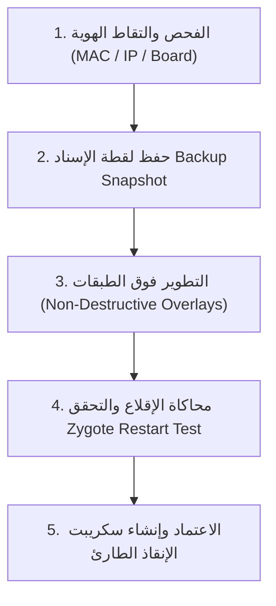

# 🛡️ بروتوكول الأمان الهندسي والتحقق المسبق للشاشات الذكية v1.0
## (The Smart TV Pre-Flight, Non-Destructive Deployment & Auto-Rollback Protocol)
### 🏛️ معتمد لجميع شاشات وأجهزة الأندرويد الحالية والمستقبلية (ميدياستار، أبوللو، TCL، وغيرها)

---

## 🛑 القوانين الحديدية الثلاثة لتطوير الشاشات (The 3 Iron Rules)

### 1. حظر تعطيل لانشر المصنع جذرياً (The Vendor Launcher Invariant)
* **القاعدة**: يُمنع منعاً باتاً تنفيذ أمر `pm disable` على مشغل المصنع الأصلي لأي شاشة (مثل `cn.cultraview.launcher` أو `com.google.android.tvlauncher`).
* **السبب الهندسي**: لوحات التلفاز تملك خدمات إقلاع مادية خاصة بالعتاد (`TvBoot` / `Hardware Watchdog`) مبرمجة في الروم للبحث عن لانشر المصنع لإرسال إشارة خروج شاشة التمهيد (`bootanimation.exit`).
* **البديل الآمن 100%**: استبدال الواجهة عبر طبقة الـ Intent فقط:
  ```bash
  cmd package set-home-activity com.gathin.tvhome/.MainActivity
  ```
  بهذه الطريقة، يعمل اللانشر الجديد كواجهة افتراضية سلسة وخفيفة، ويبقى كود المصنع حياً في الخلفية لمنع أي تعليق في الإقلاع البارد.

### 2. قاعدة فحص تبعيات الحزم المسبق (Pre-Flight Dependency Check)
* قبل تعطيل أي حزمة، يجب فحص علاقتها بالعتاد:
  * هل تشارك `sharedUserId="android.uid.system"`؟
  * هل ترتبط بمدخلات التلفاز `TvInput` أو معالج الإشارة `Amlogic / MStar / MediaTek`؟
  * إذا كانت مرتبطة بالنظام، تُترك مفعلة ويتم حجب واجهتها فقط دون إيقاف خدمتها.

### 3. قاعدة حزام الأمان والنسخ الاحتياطي الفوري (Snapshot Before Touch)
* قبل إجراء أي تعديل على أي شاشة، يتم تلقائياً سحب نسختين:
  1. قائمة الحزم المشغلة وحالتها: `pm list packages -e > enabled_packages.txt`
  2. إعدادات النظام الحالية: `settings list global > global_settings.txt`

---

## 🔄 مراحل خط إنتاج وتطوير الشاشات الآمن (5-Step Safe Pipeline)



### المرحلة 1: التقاط الهوية وحجز الآيبي (Static Network Reservation)
* تسجيل الـ MAC Address السلكي واللاسلكي للشاشة لتثبيت الـ IP في الراوتر منعاً لتغيره.
* التأكد من فتح منفذ الـ ADB السلكي واللاسلكي.

### المرحلة 2: لقطة الإسناد الأوتوماتيكية (Automated Snapshot)
* سكريبت آلي يحفظ حالة الشاشة بنقرة واحدة لضمان الرجوع لها بـ 0 مخاطرة.

### المرحلة 3: التطوير غير الهدام (Non-Destructive Enhancements)
* تثبيت التطبيقات الخفيفة المخصصة (Clean Launcher, SmartTube, Cast Tools).
* تسريع الرسوم عبر إعدادات العرض العالمية دون المساس بملفات الـ Framework:
  ```bash
  settings put global window_animation_scale 0.5
  settings put global transition_animation_scale 0.5
  settings put global animator_duration_scale 0.5
  ```

### المرحلة 4: اختبار حلقة الإقلاع بدون قطع الكهرباء (Soft-Boot Simulation)
* قبل تسليم الشاشة، يتم اختبار الإقلاع برمجياً بينما الـ ADB متصل:
  ```bash
  am restart
  ```
* إذا فتحت الشاشة بسلاسة خلال 5 ثوانٍ، يتم اعتماد التعديل بأمان تام.

### المرحلة 5: ملف الإنقاذ الذاتي بنقرة واحدة (`emergency_rescue.bat`)
* كل شاشة يتم تطويرها يُنشأ لها ملف إنقاذ خاص بها في مجلد المشروع، يعيد ربطها وتشغيلها بنقرة زر واحدة فوراً دون الحاجة لأي تدخّل يدوي.
